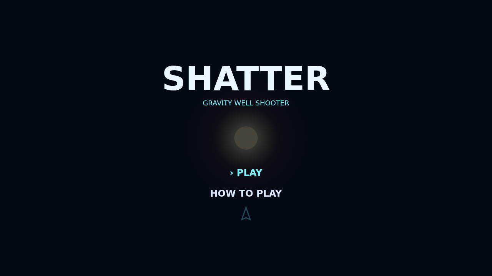

# Shatter

Shatter is a fast, luminous asteroid hunt built around a star that bends every ballistic shot. Drift through deep space under momentum, lead your targets, and use the well to create impossible-looking curves.

Large rocks carry armor, then split into faster fragments. Clear every last shard to push into the next, denser wave.

When a rock is about to get away, launch the heavy homing torpedo. It flies straight through the well, locks onto targets ahead, and comes back online after a tense ten-second recharge.

